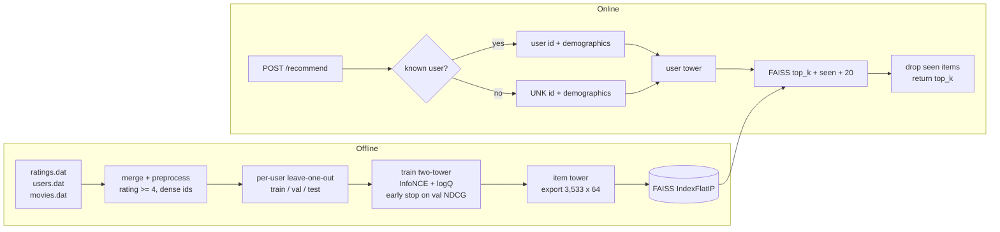

# Two-Tower Retrieval on MovieLens-1M: an Evaluation-First Build

A movie retrieval system built from scratch: PyTorch two-tower model, honest full-catalog evaluation, fairly tuned baselines, FAISS retrieval, and a FastAPI + Docker serving layer.

## TL;DR

- Built a two-tower retriever (in-batch InfoNCE) and tested it against tuned BPR-MF, ItemKNN, popularity, and an MF trained with the **same loss**.
- **Biggest win: logQ correction.** My first two-tower scored *below plain popularity* on full-catalog ranking. Fixing popularity bias in the in-batch loss lifted NDCG@10 from 0.016 to **0.0347 ± 0.0007** (3 seeds), about 2.2x.
- **Honest negative result:** MF trained with the same loss scores higher (**0.0404 ± 0.0018**, gap about 3 std). On warm users, the loss mattered more than the architecture.
- **Cold-start is a statistical tie** with popularity baselines (bootstrap CIs span zero). Reported as is.
- I audited my own evaluation and found 10 mistakes, listed in [What I got wrong](#9-what-i-got-wrong). That section is the most useful part of this repo.

---

## Table of contents

1. [Objective](#1-objective)
2. [System overview](#2-system-overview)
3. [Data](#3-data)
4. [Model and loss](#4-model-and-loss)
5. [Evaluation protocol](#5-evaluation-protocol)
6. [Results](#6-results)
7. [Cold-start](#7-cold-start)
8. [Serving and latency](#8-serving-and-latency)
9. [What I got wrong](#9-what-i-got-wrong)
10. [Design decisions and trade-offs](#10-design-decisions-and-trade-offs)
11. [Limitations and next steps](#11-limitations-and-next-steps)
12. [Project structure](#12-project-structure)
13. [Reproduce](#13-reproduce)

---

## 1. Objective

**Build the retrieval stage of a recommender and make every reported number defensible.**

Real recommenders run in two stages: *retrieval* narrows thousands or millions of items to a few hundred candidates, and *ranking* orders them with a heavier model. This project covers retrieval only.

Goals, in priority order:

1. **Trustworthy evaluation.** Full-catalog ranking, leak-free splits, uniform sampled negatives, multiple seeds.
2. **Fair baselines.** Tuned BPR-MF, ItemKNN, popularity, and MF trained with the same loss as the two-tower, so the architecture is isolated from the loss.
3. **A model that is understood, not just scored.** Diagnose why it underperforms, fix the root cause, and report where it still loses.
4. **A serving path that matches what was evaluated.** The indexed and served checkpoint is the evaluated one, and the API filters already-seen items.

Non-goals: scale (3.5K items), a ranking stage, online metrics.

---

## 2. System overview



The engineering benefit of the two-tower shape: item vectors are computed **once, offline**. At request time only the user tower runs, followed by a nearest-neighbor lookup.

---

## 3. Data

Dataset: **MovieLens-1M** (explicit 1 to 5 star ratings).

| Step | Users | Items | Interactions |
|---|---|---|---|
| Raw | 6,040 | 3,706 | 1,000,209 |
| **Ratings >= 4 (used by every model)** | **6,038** | **3,533** | **575,281** |

- **Positive = rating of 4 or 5.** A 1-star rating is not a preference signal. Cost: about 43% of interactions and 173 items dropped.
- **Sparsity** after filtering: about 97.3%.
- **Split: per-user leave-one-out by timestamp.** Last positive goes to test, second-to-last to validation, the rest to train.

| Split | Rows |
|---|---|
| Train | 563,211 |
| Validation | 6,035 |
| Test | 6,035 |

Three users have fewer than 3 positives and stay in train only. A single global date cutoff was rejected because about 95% of ratings fall in 2000 to early 2001.

---

## 4. Model and loss

```
 USER TOWER                                  ITEM TOWER
 user id   -> embedding (64)                 item id -> embedding (64)
 gender    -> 1 dim                          genres  -> 18-dim multi-hot
 age       -> embedding (4)                          |
 occupation-> embedding (8)                  concat -> MLP [128 -> 64]
        |                                            |
 concat -> MLP [128 -> 64]                   linear -> L2 normalize
        |                                            |
 linear -> L2 normalize                       item vector (64)
        |                                            |
   user vector (64) -------- dot product --------> cosine score
```

- **L2 normalization:** dot product equals cosine similarity, and it matches inner-product search in FAISS.
- **UNK user row:** the user embedding table has one extra row (index `num_users`) for unseen users.
- **Hyperparameters:** dim 64, MLP [128, 64], dropout 0.1, batch 512, Adam lr 1e-3, weight decay 1e-5, temperature 0.1, early stopping patience 5.

### Training loss: in-batch InfoNCE

Each step takes 512 real (user, item) pairs. For user *i*, item *i* is correct and the other 511 items are free negatives. The loss is cross-entropy over the 512 x 512 score matrix, in both directions (user to item, item to user).

### The key fix: logQ correction

In-batch negatives are sampled in proportion to popularity, so popular items are used as "wrong answers" far more often than their true weight justifies. The model learns to push them down and then under-recommends them.

**Fix:** subtract `log q(item)` from the user-to-item logits during training, where `q` is the item's share of training interactions (plus 1 smoothing). Only the user-to-item direction is corrected, since the bias comes from items acting as negatives. Serving uses plain scores.

```python
u2i = logits - log_q[None, :] if log_q is not None else logits
loss_u2i = F.cross_entropy(u2i, labels)
loss_i2u = F.cross_entropy(logits.T, labels)      # uncorrected
```

---

## 5. Evaluation protocol

| | **Full-catalog (primary)** | Sampled 1+99 (secondary) |
|---|---|---|
| What | Rank the held-out item against **all** 3,533 items | Rank it against 99 random unseen items |
| Masking | Train (and val for test) items hidden; held-out item never hidden | Negatives exclude all of the user's train, val, and test items |
| Negatives | n/a | **Uniform** (NCF-style) |
| Numbers | Small (about 0.03 to 0.04), normal at this size | Large (about 0.35 to 0.42), inflated |
| Role | **The judge** | Reference only |

- Metrics: NDCG@10, Recall@10. With one held-out item per user, Recall@10 equals HR@10.
- **Per-user averaging**, so power users (up to 2,314 ratings) cannot dominate.
- **Model selection:** early stopping on validation **full-catalog** NDCG@10. The best checkpoint is tested once.
- **Seeds:** main-table models are trained with 3 seeds and reported as mean ± std (sample std, n=3, so a rough estimate).
- One evaluator serves every model through a `score_fn(users) -> (B, num_items)` adapter, so popularity, ItemKNN, MF, and the two-tower share identical evaluation code.

---

## 6. Results

All numbers: test set, per-user averages.

### Full-catalog ranking (primary)

| Model | NDCG@10 | Recall@10 | Seeds |
|---|---|---|---|
| MF, InfoNCE + logQ (ID-only, no MLP) | **0.0404 ± 0.0018** | **0.0830 ± 0.0036** | 3 |
| Two-Tower + features + logQ | 0.0347 ± 0.0007 | 0.0707 ± 0.0023 | 3 |
| Two-Tower ID-only + logQ | 0.0339 ± 0.0013 | 0.0679 ± 0.0026 | 3 |
| BPR-MF (best of 5 tuned variants) | 0.0315 | 0.0623 | 1 |
| ItemKNN (cosine, no shrinkage) | 0.0308 | 0.0615 | 1 |
| Popularity | 0.0193 | 0.0411 | deterministic |
| *Two-Tower + features, **no** logQ* | *0.0160* | *0.0335* | 1 |
| *Two-Tower ID-only, **no** logQ* | *0.0154* | *0.0338* | 1 |

### Sampled 1+99, uniform negatives (secondary, single seed)

| Model | NDCG@10 |
|---|---|
| MF, InfoNCE + logQ | 0.4169 |
| Two-Tower + features + logQ | 0.4046 |
| Two-Tower ID-only + logQ | 0.3972 |
| BPR-MF (tuned) | 0.3532 |
| Popularity | 0.2589 |

### How to read these numbers

1. **logQ is the largest effect.** 0.0160 to 0.0347 is about 2.2x, far outside seed noise. Without it the two-tower sat below popularity (0.0193).
2. **MF with the same loss beats the two-tower.** Gap 0.0057, about 3 standard deviations of the MF runs. Real, not luck.
3. **The loss mattered more than the architecture.** BPR-MF to InfoNCE-MF is +0.0089 NDCG; InfoNCE-MF to two-tower is -0.0057.
4. **Two-tower vs classic baselines:** about 10% above BPR-MF and 13% above ItemKNN. Those two baselines are single seed, so treat this as likely, not proven.
5. **Side features: no significant difference on warm users** (0.0347 vs 0.0339, gap smaller than the spread).
6. **BPR tuning plateaued** at 0.031 to 0.032 across 4 or 8 negatives and several learning rates. Weight decay 1e-4 collapsed it to 0.019.
7. **Why the numbers are small:** each user has one held-out movie, ranked against 3,533. Full-catalog NDCG@10 of about 0.03 to 0.04 is normal for this setup. The 0.4 range comes from the easier sampled protocol.

### Embedding-size ablation (old protocol, single seed, reference only)

| Dim | NDCG@10 (old sampled protocol) | Sec / epoch |
|---|---|---|
| 32 | 0.252 | 44.8 |
| 64 | 0.259 | 41.2 |
| 128 | 0.254 | 97.6 |

Run before the evaluation fixes. Gaps are within noise. Dim 64 was chosen for cost, **not** because it is proven optimal.

---

## 7. Cold-start

**Question:** can the model serve a user with no history, using only gender, age, and occupation?

### Leak-free design

- Hold out **1,000 users**: all their train and validation rows removed, test item kept for scoring.
- Cold users get the shared **UNK embedding plus real demographics**.
- **User-ID dropout (p = 0.15)** during training replaces real IDs with UNK. Without it, the UNK row is never trained and the test measures noise.
- Baselines: global popularity, and **segment popularity** (gender x age x occupation, backing off to a coarser group when a segment has fewer than 20 users).
- Metric: full-catalog ranking with each cold user's history hidden.

### Result (1,000 users, single seed)

| Method | NDCG@10 | Recall@10 |
|---|---|---|
| Segment popularity | **0.0247** | 0.0520 |
| Two-Tower (UNK + demographics) | 0.0227 | 0.0480 |
| Global popularity | 0.0209 | 0.0420 |

Paired bootstrap (2,000 resamples):

- Two-Tower minus global popularity: +0.0018, 95% CI [-0.0030, +0.0066]
- Two-Tower minus segment popularity: -0.0020, 95% CI [-0.0068, +0.0026]

**Both intervals span zero: a statistical tie.** Three coarse demographic fields carry little signal. Established instead: the evaluation is leak-free, ID dropout does not hurt warm users (5,035 warm users: 0.0359 vs 0.0355), and the serving path handles unknown users through UNK. The realistic fix is a history-based user tower, listed under next steps.

---

## 8. Serving and latency

**Offline:** item vectors for all 3,533 items are computed from the evaluated checkpoint (side features included) and stored in a FAISS `IndexFlatIP`.

**Per request:**

1. Known user: trained ID + stored demographics. Unknown user: must send `gender`, `age`, `occupation`, and gets the UNK embedding.
2. Run the **user tower only**.
3. Fetch `top_k + (#seen items) + 20` from FAISS, **drop already-watched movies**, return the top K with titles, genres, scores.

Stack: FastAPI, Pydantic schemas, Docker, models and index loaded once at startup, 24 pytest tests (including seen-item filtering and the UNK path).

### Latency (CPU laptop, 3,533 items, exact search, 200 users, one uvicorn worker, warm model)

| Measurement | p50 | p99 |
|---|---|---|
| Retrieval only (user tower + FAISS, in-process) | 1.4 ms | 3.3 ms |
| End-to-end HTTP, localhost (includes seen-item filtering) | 13.2 ms | 24.7 ms |

Caveats: localhost excludes real network time; retrieval-only excludes the over-fetch and filter step; 3.5K items says nothing about million-item scale. Exact search is the right choice at this size (perfect recall, no tuning); IVF or HNSW only pay off at much larger catalogs.

---

## 9. What I got wrong

Found by auditing my own work. Each one changed my conclusions.

| # | Mistake | How I found it | Fix | Effect |
|---|---|---|---|---|
| 1 | Eval negatives were popularity-weighted, yet I called the protocol "NCF-comparable" | Compared code to the NCF protocol | Uniform negatives as default; both modes kept | The old "+78% over MF" vanished: under uniform negatives MF (0.354) beat my old two-tower (0.280) |
| 2 | Both negative modes gave identical numbers | Suspicious re-eval output | Sampler had `hard_ratio=0.5` hardcoded | Real numbers appeared |
| 3 | Sampled metrics hid a failure | Added full-catalog eval | Made full ranking the primary metric | Old two-tower (0.0160) was **below popularity** (0.0193); sampled metrics had them level |
| 4 | Popularity bias in the in-batch loss | Diagnosed why popular items were under-ranked | logQ correction | 0.0160 to 0.0347 (3 seeds) |
| 5 | Cold-start test was not cold | Reviewed what `score()` received | Held-out users, UNK row, ID dropout, segment-popularity baseline, bootstrap CIs | A claimed win became a statistical tie |
| 6 | MF baseline was weak | Review | 5 BPR variants, ItemKNN, and MF with the same loss | Headline shrank, became defensible |
| 7 | Docs disagreed with the code and data | Truth-check script on row counts | Docs now state ratings >= 4, 575,281 rows, in-batch-only training | Credibility |
| 8 | Served index was built from a model without features | Config mismatch | Rebuilt from the evaluated checkpoint | Served model equals reported model |
| 9 | 2-second end-to-end latency | Latency script | Windows resolved `localhost` to IPv6 first; use `127.0.0.1` | 2,043 ms to 13.2 ms p50. Compute was never the problem |
| 10 | **First "3-seed" run was a single seed repeated.** `--seed` was parsed but never passed into `main()` | Epoch-1 loss was identical (6.0585) across all runs | Wired the argument through; added per-seed checkpoint suffixes | A single earlier run (0.0364) was on the high side; the 3-seed mean is **0.0347 ± 0.0007** |

Smaller process lessons: pasting a function over `evaluate.py` once deleted `evaluate_model` (append, never overwrite unread files); a stale old server on port 8000 once answered my latency requests; 7 tests needed fixture updates after the UNK-row change.

---

## 10. Design decisions and trade-offs

| Decision | Why | What it costs |
|---|---|---|
| Positives = ratings >= 4 | Cleaner preference signal | 575K vs 1M interactions, 173 fewer items |
| Per-user time-based leave-one-out | No future-to-past leakage; standard protocol | Global timeline still overlaps across users (mild leakage) |
| Full-catalog ranking as the judge | Sampled metrics reordered my models | Small, unflashy numbers |
| Sampled metrics reported too, uniform negatives | Comparable to NCF-style numbers | Easy test, inflated |
| In-batch negatives | No sampling pipeline; scales to large batches | Popularity bias (fixed by logQ); false negatives not masked |
| logQ on user-to-item direction only | Bias comes from items used as negatives | Scores carry popularity again; coverage not yet measured |
| L2-normalized outputs, temperature 0.1 | Cosine scores, stable training, matches `IndexFlatIP` | Temperature is a sensitive knob and was not tuned |
| MF baseline trained with the same loss | Isolates architecture from loss | Showed the two-tower is not the winner on warm users |
| UNK row + ID dropout | Makes the UNK embedding actually learn | Needs a retrain; no warm-user harm observed |
| Early stopping on full-catalog val NDCG | Selection aligned with the reported metric | Slower per-epoch validation |
| Exact FAISS index | Right size for 3.5K items | Scale story untested |
| Over-fetch then filter seen items | Simple, fast at this size | Slightly more work per request |
| Keep MF as a baseline instead of "improving" the two-tower | The honest comparison is the point | A less flattering headline |

---

## 11. Limitations and next steps

**Limitations**

- **Seeds:** the three main-table models use 3 seeds. BPR-MF, ItemKNN, no-logQ runs, and cold-start are single seed.
- **Two-tower does not beat same-loss MF on warm users**, and side features add nothing measurable there.
- **Cold-start is a tie.** Three coarse demographic fields carry little signal.
- **Time order is per user only**, so mild global temporal leakage remains.
- **Small catalog (3,533 items), ML-1M only.** Findings may not transfer; no scale benchmark.
- **No popularity-bias metrics** (coverage, long-tail recall) even though logQ changes popularity behavior.
- **False negatives** in in-batch training are not masked.
- Latency is localhost, CPU, exact search. The served checkpoint is the cold-trained seed-42 model, not one of the three seed-run models.
- Offline metrics are not online results.

**Next steps, in order**

1. Seeds for baselines; 5 seeds on the main table.
2. Coverage and long-tail recall, with and without logQ.
3. A history-based user tower (average of the last N watched items) for a real cold-start path.
4. Scale benchmark: Flat vs IVF vs HNSW on about 1M synthetic vectors, recall@10 vs p99.
5. A second dataset through the same evaluation pipeline.
6. Two-stage system (retriever + ranker), false-negative masking, online A/B testing.

---

## 12. Project structure

```
src/
  models/       two_tower.py, baseline_mf.py, losses.py
  data/         preprocess.py, dataset.py, features.py, splits.py
  retrieval/    build_index.py, search.py
  train.py, train_mf.py, evaluate.py
scripts/        phase0_truth_check, phase1a/1b re-evals, phase1c seeds,
                phase2a ItemKNN, phase2b MF variants, phase3 cold-start,
                phase4 latency
serving/        app.py, schemas.py, model_loader.py, requirements.txt
demo/           streamlit_app.py
configs/        train_config.yaml, retrieval_config.yaml
results/        metrics and comparison JSON files
tests/          24 passing pytest tests
Dockerfile
```

Note: `search.py`, `train_mf.py`, `run_ablation.py`, and `evaluate_coldstart.py` predate the evaluation fixes and are kept as history (the last is the leaky cold-start test from mistake 5).

---

## 13. Reproduce

```bash
pip install -r requirements.txt

# data
python -m src.data.preprocess --rating_threshold 4
python -m src.data.splits
python -m scripts.phase0_truth_check          # prints row counts and threshold check

# train (main table: repeat with --seed 1, 2, 3)
python -m src.train --config configs/train_config.yaml --with_features --logq --seed 1
python -m src.train --config configs/train_config.yaml --logq --seed 1
python -m scripts.phase1c_mf_seeds            # MF InfoNCE+logQ, 3 seeds
python -m scripts.phase1c_summary             # mean ± std table

# baselines and analysis
python -m scripts.phase2a_itemknn
python -m scripts.phase2b_mf
python -m scripts.phase3_cold_eval

# cold-start model used for serving
python -m src.train --config configs/train_config.yaml --with_features --logq --cold 1000 --id_dropout 0.15

# index, serve, benchmark, test
python -m src.retrieval.build_index
uvicorn serving.app:app --host 127.0.0.1 --port 8000
python -m scripts.phase4_latency
python -m pytest -q
```

Example requests:

```bash
# known user
curl -X POST http://127.0.0.1:8000/recommend -H "Content-Type: application/json" \
  -d '{"user_id": 1, "top_k": 5}'

# unknown user (must send demographics)
curl -X POST http://127.0.0.1:8000/recommend -H "Content-Type: application/json" \
  -d '{"gender": "M", "age": 25, "occupation": 7, "top_k": 5}'
```

Environment note: on Windows, `KMP_DUPLICATE_LIB_OK=TRUE` is set to work around a duplicate OpenMP runtime between PyTorch and FAISS. It works but is an unsafe workaround.

---

**Tech:** PyTorch, FAISS (`faiss-cpu`), FastAPI, Pydantic, Docker, Streamlit, pytest. Dataset: MovieLens-1M.